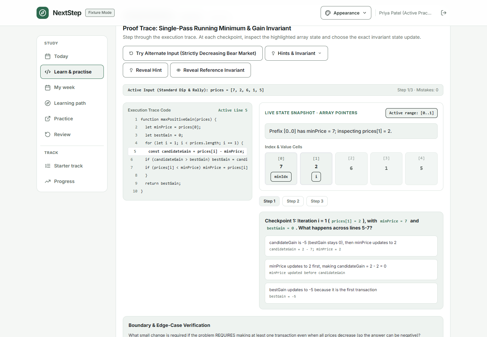
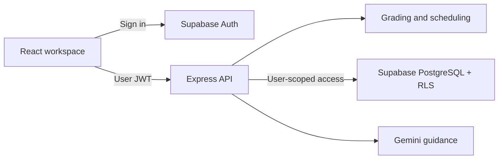

# NextStep

### Big goals. A doable today.

NextStep helps students turn DSA preparation into a practical learning routine: choose a manageable activity, reason through an algorithm, get feedback, and adapt the next week when life changes.

Built for the **Build to Ship Hackathon**.

**[Open the live app](https://next-step-six-theta.vercel.app/)** · **[Run locally](nextstep-hackathon-2026-10-07/START-HERE.md)** · **[Explore the architecture](nextstep-hackathon-2026-10-07/contracts/ARCHITECTURE.md)** · **[Verification evidence](nextstep-hackathon-2026-10-07/docs/FULL-LOCAL-QA-RESULT.md)**

> The adaptive-practice release in this branch has passed the local release gate. Production updates require merging the PR and deploying both frontend and backend; the live link may serve an earlier release until then.



*Actual local application screenshot using a labelled synthetic account.*

## The problem

A long problem list does not tell a student what to do in the next 30 minutes. A missed week creates backlog. Reading a solution can feel like understanding it, even when the student cannot explain the next state change.

NextStep connects the plan to the practice: available time determines the schedule, interactive predictions expose misunderstandings, and recorded difficulties guide the next activity.

## What to try

| Student question | NextStep's response |
| --- | --- |
| What should I do now? | Today presents one recommended activity with its estimated effort and reason. |
| Do I understand the algorithm? | Learn & practise pairs explanations with code, visual state, predictions and boundary checks. |
| I need another example. What next? | Adaptive practice uses saved check-ins and evaluated attempts to suggest a short, targeted session. |
| I missed a few days. | Preview a revised schedule and explicitly accept it while keeping completed work. |
| What happens after the 12 missions? | Continue through the curriculum, foundations checkpoint, weekly plans, practice library and review queue. |

### A short evaluator walkthrough

1. Set a goal and weekly availability, then inspect the recommendation on **Today**. The optional **Getting started** guide explains the workflow.
2. Open **Learn & practise**. Inspect the code and array state, make a prediction, try a boundary case, and save an evaluated attempt.
3. Open **Learning path** to see the curriculum and topic evidence. Use **Practise what needs work** to inspect a 10-, 20- or 30-minute proposal.
4. Open **My week** and preview a plan. Acceptance is explicit; previewing does not change the student's schedule.
5. Visit **Review** and **Progress** to inspect recorded evidence and export a study snapshot.

The starter track and curriculum are both available; students do not have to finish all 12 starter missions before exploring lessons.

## Beyond the starter track

The 12 missions introduce a manageable study routine. They are the starting point, not a cap on the product.

| Published content | Count | What it contains |
| --- | ---: | --- |
| DSA topics | 12 | Arrays, hashing, binary search, two pointers, sliding windows, linked lists, stacks/queues, trees, heaps, graphs, backtracking and dynamic programming |
| Lessons | 48 | Explanations, worked examples, reference code, pitfalls and knowledge checks |
| Interactive traces | 18 | Primary/alternate inputs, prediction checkpoints and edge-case questions |
| External practice problems | 120 | Curated LeetCode links with topic, difficulty and practice guidance |

After the starter track, students can take the current **three-question foundations checkpoint**, choose a capacity-aware continuation plan, or continue directly through the learning path. Short practice sessions connect their recorded difficulties to relevant examples, checks and retries.

**Evidence stays honest:** internal trace outcomes are server-graded; viewing an example is recorded as viewed; external problem outcomes remain self-reported. Confidence selections do not change grades. Completing the track does not establish interview readiness.

## How it works



- **Frontend:** React, Vite, React Router, Tailwind CSS and Lucide icons. Three visual styles—Frosted Sage, Study Journal and Quiet Focus—each support light/dark appearance.
- **Backend:** Node.js, Express, Zod validation and server-side Gemini guidance.
- **Data integrity:** user-scoped access, version compare-and-set writes, bounded histories and request replay checks. Correct-answer keys are excluded from the public catalog.
- **Hosting:** Vercel frontend, Render API, Supabase authentication and database.

Gemini provides contextual guidance. Grading and schedule updates use deterministic application logic; AI does not silently complete missions or apply a plan.

## Run locally

The application lives in **`nextstep-hackathon-2026-10-07/`**. Use Node.js 24 LTS and run these commands from that directory:

```sh
cd nextstep-hackathon-2026-10-07
npm --prefix client ci
npm --prefix server ci
```

### Inspect without cloud credentials

```sh
npm --prefix client run preview:synthetic -- --strictPort
```

Open **http://127.0.0.1:5173**. This mode is labelled **Fixture Mode** and uses synthetic local data instead of live authentication and saved student records.

Use `student.active@nextstep.local` with synthetic password `password123`. For the completed-starter state, use `student.completed@nextstep.local` with the same synthetic password. These are local test personas, not production credentials. External practice links and live-provider behavior are separate from this preview.

### Develop against the live services

Follow **[START-HERE.md](nextstep-hackathon-2026-10-07/START-HERE.md)** for environment templates, migrations and Supabase redirects. Create environment files only when absent; preserve existing configuration.

Run in separate terminals from the application directory:

```sh
npm --prefix server run dev
```

```sh
npm --prefix client run dev
```

Normal development uses the configured Express API and Supabase services. Gemini guidance requires server-side provider configuration. Never put AI or privileged database keys in frontend variables.

## Verification

From the application directory:

```sh
npm --prefix server test
npm --prefix client test
node server/scripts/validate-curriculum.mjs
npm --prefix client run build
```

With the synthetic preview running, the Windows browser release gate is:

```powershell
powershell -ExecutionPolicy Bypass -File scripts/verify-continuation-release.ps1
```

The gate accepts a `-PlaywrightModule` path; use your own installed Playwright location if the local default is unavailable. See the script parameters for preview URL configuration.

**Latest independently executed local gate: 155 server tests, 152 client tests, production build and all 15 verification groups passed.** The 12 starter completion flows were also repeated through the UI with reload checkpoints.

This is sampled browser and route/unit evidence. Exhaustive browser coverage of all lesson/trace combinations, real novice usability and authenticated production acceptance remain separate. The [corrected QA report](nextstep-hackathon-2026-10-07/docs/FULL-LOCAL-QA-RESULT.md) records what was checked and what remains pending.

## Repository map

```text
nextstep-hackathon-2026-10-07/
├── client/       React application and browser checks
├── server/       API, grading, scheduling and curriculum
├── contracts/    API and architecture specifications
├── database/     SQL migrations and access policies
├── docs/         Setup, release evidence and historical reports
└── scripts/      Project validation and release tooling
```

- [Developer setup](nextstep-hackathon-2026-10-07/START-HERE.md)
- [Documentation index](nextstep-hackathon-2026-10-07/docs/README.md)
- [API contract](nextstep-hackathon-2026-10-07/contracts/API-V1.md)
- [Deployment runbook](nextstep-hackathon-2026-10-07/docs/06-deployment-and-release.md)
- [Contribution and preservation rules](nextstep-hackathon-2026-10-07/AGENTS.md)

Keep feature changes in reviewed branches. Preview and test locally before merging; verify Vercel and Render separately after deployment.
